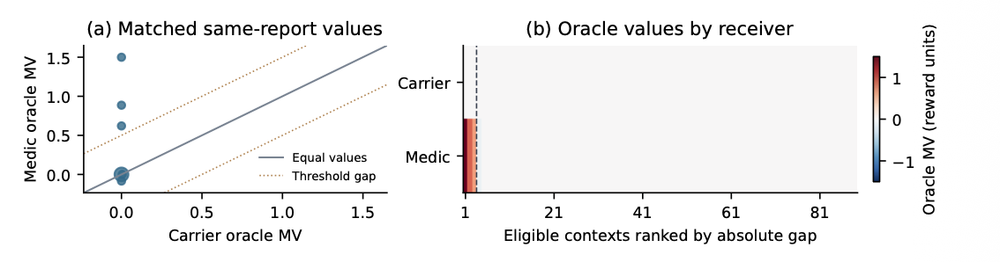
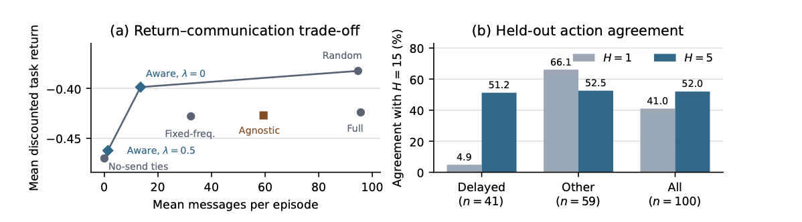
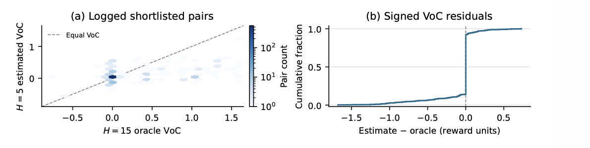

# Receiver-Aware Communication for Search and Rescue

Course Project for **CS329: Foundations of AI**  
**Instructor:** Prof. Manisha Padala, Indian Institute of Technology Gandhinagar

We study whether a search-and-rescue team should share an existing report, which teammate should receive it, and whether the expected benefit is worth the communication cost. The project uses a grid-based simulation with three fixed roles: the **Scout** finds victims, the **Medic** stabilizes victims and disables hazards, and the **Carrier** transports stabilized victims to the evacuation cell.

## Submitted by

| Name | Department | Institute | Student ID |
|---|---|---|---|
| Chitiveli Hemcharan Varma | Computer Science | Indian Institute of Technology Gandhinagar | 24110095 |
| Guransh Kaur Saran | Computer Science | Indian Institute of Technology Gandhinagar | 24110127 |
| Kowel P Laloo | Computer Science | Indian Institute of Technology Gandhinagar | 24110168 |
| Omm Arindam | Artificial Intelligence | Indian Institute of Technology Gandhinagar | 24110229 |

## Start here

1. **Read the final report:** [report_final.pdf](report_final.pdf).
2. **Explore the results:** see the three complete research figures below, each with both panels.
3. **Try the interactive demo:** follow the setup instructions below.

## Research results and screenshots

The following images reproduce Figures 2, 3 and 4 from the final report. They show the receiver comparison, the communication/return trade-off and lookahead agreement, and Value-of-Communication (VoC) estimation diagnostics. The reported figures come from the research experiments; the interactive demo described later is an illustration and is not a substitute for those experiments.

### Figure 2 — Receiver-specific value of the same report



*Figure 2(a)* compares the 15-step oracle marginal value (MV) of the same report for the Medic and Carrier. *Figure 2(b)* displays the receiver-specific values for 89 eligible contexts ranked by absolute receiver gap. Only **3 of 89** designated reports exceeded the receiver-difference threshold of 0.5, so the predeclared receiver-dependence criterion was **not met**.

### Figure 3 — Communication efficiency and lookahead



*Figure 3(a)* shows mean discounted task return versus messages per episode across communication policies. Five-step receiver-aware selection sent **135 messages versus 957** for the full-send baseline (**85.89% fewer**), but completed **10 rescues versus 17**, so lower traffic did not preserve rescue count. *Figure 3(b)* compares exact action agreement with the 15-step offline reference: on **41 delayed contexts**, agreement increased from **4.9% at one step** to **51.2% at five steps** (a gain of **46.34 percentage points**).

### Figure 4 — Accuracy of VoC estimates



*Figure 4(a)* compares five-step estimated VoC with the 15-step offline oracle for logged shortlisted candidate pairs. *Figure 4(b)* shows the cumulative distribution of signed estimation residuals. Both panels summarize **684 scored pairs** from **100 held-out contexts** across ten seeds. This comparison reflects both estimator/model error and differences in lookahead horizon.

### Selected findings

| Measure | Result |
|---|---|
| Designated receiver-value gaps above threshold | 3/89 (3.37%); H1 not met |
| Five-step vs. one-step agreement on delayed contexts | +46.34 percentage points; H3 met |
| Receiver-aware vs. full-send messages | 135 vs. 957 (85.89% fewer) |
| Completed rescues in that comparison | 10 vs. 17 |
| Reduction in positive-send rate as the cost weight increases from 0 to 0.5 | 89.84%; H4 met |
| Assigned two-message-budget comparison | No clear receiver-aware return advantage; reported interval includes zero |

For uncertainty intervals, definitions, experimental settings, all additional figures and limitations, see [report_final.pdf](report_final.pdf). These results should not be confused with individual interactive-demo episodes.

## Run the interactive demo (Windows / macOS / Linux)

**Requirements:** Python 3.10 or later and Git.

### macOS / Linux

Clone the repository, if you have not already:

```bash
git clone https://github.com/Oreo016/fai-draft-1.git
cd fai-draft-1
```

From the repository root, create a virtual environment, activate it, install the project and run the demo:

```bash
python3 -m venv .venv
source .venv/bin/activate
python -m pip install -e .
python demo/app.py
```

Open **http://127.0.0.1:8765** in a browser. Stop the server with `Ctrl+C`.

On later sessions, **do not recreate the environment**; just activate it and restart the demo from the project directory:

```bash
source .venv/bin/activate
python demo/app.py
```

Type `deactivate` when you are done using the virtual environment.

The **Compare one report** page estimates the difference between sending a discovered-victim report to the Medic or Carrier and withholding it, accounting for message cost. **Play an episode** visualizes the Scout, Medic and Carrier. For a quick rescue walkthrough, choose the small map, the always-send policy, message cost `0`, and scenario `0`. See [demo/README.md](demo/README.md) for more details.

### Windows (PowerShell)

Clone the repository if you have not already:

```powershell
git clone https://github.com/Oreo016/fai-draft-1.git
cd fai-draft-1
```

From the repository root, create a virtual environment, activate it, install the project and run the demo:

```powershell
py -m venv .venv
.\.venv\Scripts\Activate.ps1
python -m pip install -e .
python demo/app.py
```

Open **http://127.0.0.1:8765** in a browser. Press `Ctrl+C` to stop the server.

For later sessions, from the repository root, run:

```powershell
.\.venv\Scripts\Activate.ps1
python demo/app.py
```

Type `deactivate` when finished.

If PowerShell blocks script activation, first run these commands in the same PowerShell window:

```powershell
Set-ExecutionPolicy -Scope Process -ExecutionPolicy Bypass
.\.venv\Scripts\Activate.ps1
```

The execution-policy change only affects the current PowerShell process.

> Dependencies are declared in [pyproject.toml](pyproject.toml), so there is no need for a separate `requirements.txt`. Using a virtual environment also avoids Homebrew's `externally-managed-environment` installation error on macOS.

## Reproducing the work

With the virtual environment activated and the package installed, validate the default configuration and run the experiment from the repository root:

```bash
python -m voc_sar --config configs/default.yaml --validate-only
python -m voc_sar --config configs/default.yaml
```

Runs write their configuration, traces, diagnostic contexts, summaries and generated charts to a timestamped directory under `results/`. The full study can take substantially longer than an interactive demo. **The default configuration is not necessarily identical to every analysis setting used to produce the paper's reported confidence intervals**; use the corresponding recorded settings and saved experiment outputs for exact numerical comparisons.

## Repository map

- [`report_final.pdf`](report_final.pdf) — final course report.
- [`demo/`](demo/) — interactive explanation and simulator.
- [`src/voc_sar/`](src/voc_sar/) — environment, role policies, communication selection, valuation and experiments.
- [`configs/`](configs/) — default and research experiment configurations.
- [`results/`](results/) — stored experiment outputs and analyses.
- [`tests/`](tests/) — automated checks.
- [`docs/images/`](docs/images/) — Figures 2–4 used in this README.

## Scope

This is a controlled simulator study using fixed task policies. Communication starts from existing structured reports; this project does not generate natural-language messages or simulate a physical radio network. The PDF describes the methodology, findings and limitations.
